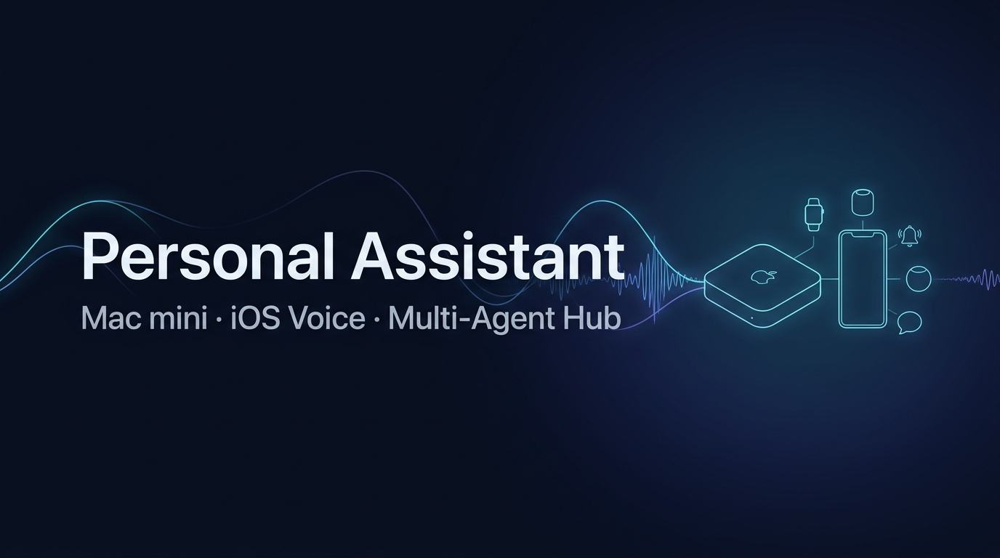
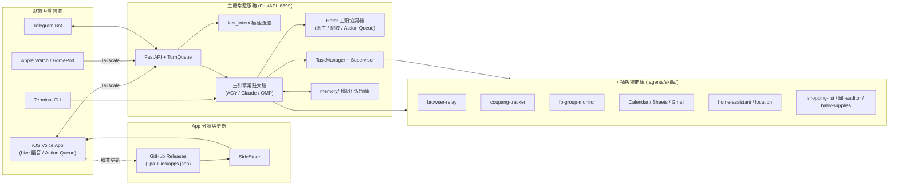

<p align="center">
  
</p>

<h1 align="center">Personal Assistant</h1>

<p align="center">
  <strong>住在家用主機上的全天候個人 AI 助理與多代理調度中樞</strong><br>
  結合 Mac mini 常駐大腦、iOS 免持語音 App、Apple Watch、HomePod 與 Telegram，打造秒級響應的隨身智慧夥伴。
</p>

<p align="center">
  <a href="https://github.com/ricky155030/personal-assistant/actions"></a>
  <a href="https://github.com/ricky155030/personal-assistant/releases"></a>
  
  
  
</p>

---

## 🌟 核心架構亮點

1. **⚡ 多核心常駐大腦引擎 (`brain_engine.py`)**：
   - 支援 **Antigravity CLI (`agy_singleton.py`)**、**Claude Code CLI (`claude_singleton.py`)** 與 **OMP (`omp_singleton.py`)** 常駐進程池，預熱連線將首字延遲降至毫秒級。
   - 支援 Low / Med / High 三級思考深度分流，並內建 **Context 上下文防線**，超過閾值或閒置超時自動重啟輪替，確保長駐不膨脹。
2. **🎙️ 原生 iOS 免持語音隨身助理 (`ios/MacMiniAssistant`)**：
   - **零延遲流式語音對話**：整合 Apple 即時語音辨識、智慧靜音 VAD 斷句與 Edge-TTS 真人神經語音，散步或開車時免持連續對話。
   - **關鍵詞語音打斷（Barge-in）**：助理說話期間不以音量盲目中斷，僅當本機 `SFSpeechRecognizer` 偵測到「等一下」或「等下」時才立即停止播放，並重置為安靜等待開口狀態。
   - **待決策佇列（Action Queue）**：頂部集中收納背景 Agent 的請示卡片，點擊選項或口語回覆即可一鍵 `relay` 回對應終端解鎖，不怕被聊天洗掉。
   - **GitHub Releases + SideStore 自動發布與更新提醒**：App 啟動時背景比對倉庫內 `ios/apps.json`，若有新 Build 會自動彈出提示橫幅並一鍵跳轉 SideStore。
3. **🧑‍✈️ 跨專案 Herdr 工頭派工與自動驗收 (`scripts/herdr_coordinator.py`)**：
   - 統一將跨專案開發任務派發至本機各 `agy` / `omp` 終端視窗，自動注入條列請示規範並掛載背景守護。
   - 完工後自動觸發無狀態 `agy -p` 驗收迴圈與失敗重試，結案時自動寫入歷史紀錄與閒置主大腦記憶。
4. **📱 四端管道分流與 1:1 鏡像同步**：
   - **Terminal CLI**：完整技術架構討論與代碼開發，不受長度限制。
   - **iOS Voice App**：支援標準 / 細節 / 深度三段語音長度約束，搭配嵌入式 HTML/SVG 視覺小卡（`<widget_html>`）。
   - **Apple Watch & HomePod**：手錶 200 字內結構化卡片、HomePod 零符號純淨口語朗讀，並與 **Telegram Bot** 1:1 鏡像同步。
5. **🧠 模組化長效記憶與背景守護 (`memory/` & `task_manager.py`)**：
   - 記憶庫解耦為 `profile.md`、`preferences.md`、`projects.md` 與 `notes.md`，每日排程審查歸檔；Google Calendar 作為待辦事項唯一真實來源。
   - 耗時監控與 CI 追蹤透過 `task_manager.py` 與 `task_supervisor.py` 秒級脫鉤，搭配心跳健康檢查與自動重啟守護。
6. **🛡️ Browser Relay 真實 Chrome 自動化**：
   - 直接操控本機真實 Google Chrome 專屬 Profile，跨平台支援 macOS / Windows / Linux，零外掛依賴並具備極強抗驗證盾能力。

---

## 🏛️ 系統架構圖



---

## 📦 模組化技能庫 (`skills/` ➔ `.agents/skills/`)

本系統採**模組化軟連結（Symlinks）架構**，所有技能存放於 `skills/` 總庫，僅在啟用時透過相對符號連結動態掛載至 `.agents/skills/`，節省 Prompt Token 並避免意圖誤判。

| 技能模組 | 類別 | 預設狀態 | 核心功能 |
| :--- | :--- | :--- | :--- |
| **`setup-wizard`** | 核心 | 🔒 **必備** | 互動式與對話式設定嚮導，管理身分、金鑰、技能開關與相依健檢 |
| **`browser-relay`** | 核心 | 🔒 **必備** | 操控本機真實 Chrome 進行 DOM 辨識、填表、點擊與批次動作 |
| **`google-calendar`** | 生產力 | 🟢 **啟用** | Google 行事曆查詢與寫入，統一維護「待辦事項」日曆 |
| **`google-sheets`** | 生產力 | 🟢 **啟用** | 雲端試算表讀寫、表頭動態對齊搜尋與批次追加 |
| **`gmail`** | 生產力 | 🟢 **啟用** | 透過 Google Workspace CLI 安全搜尋與多線程讀取郵件摘要 |
| **`shopping-list`** | 生產力 | 🟢 **啟用** | 通用待買清單管理，支援多情境分類、批次新增與快速勾銷 |
| **`ios-app-release`** | 開發 | ⚪ *可選* | iOS App 語意化升版、編譯打包 `.ipa`、更新 `ios/apps.json` 與 GitHub Release |
| **`home-assistant`** | 物聯網 | ⚪ *可選* | 控制與查詢 Home Assistant 智慧家電與溫濕度感測器 |
| **`current-location`** | 工具 | ⚪ *可選* | 透過定位資訊逆地理編碼解析目前所在區域與周邊地標 |
| **`bill-auditor`** | 財務 | ⚪ *可選* | 信用卡帳單本機解密審計、同步 Google Sheets 與固定訂閱雷達 |
| **`personal-briefing`** | 生產力 | ⚪ *可選* | 晨間個人簡報：彙整行事曆待辦與專案進度 |
| **`imessage`** | 通訊 | ⚪ *可選* | 透過 macOS 原生 iMessage 安全發送訊息（白名單保護） |
| **`coupang-tracker`** | 電商 | ⚪ *可選* | 酷澎雙軌價格監控（購物車直連 + 全網比價），降價即時通報 |
| **`fb-group-monitor`** | 社群 | ⚪ *可選* | 定期巡檢 FB 社團最新貼文，並以 LLM 語意條件過濾推播 |
| **`shopee-seller`** | 電商 | ⚪ *可選* | 拍照辨識商品、生成 SEO 文案與批次上架流程 |
| **`baby-supplies`** | 生活 | ⚪ *可選* | 待產與嬰幼兒備品清單管理，支援照片歸檔與試算表查詢 |

```bash
# 列出技能與啟用狀態 / 執行依賴健檢 (Doctor)
python3 setup.py skills list
python3 setup.py skills doctor

# 啟用或停用指定技能
python3 setup.py skills enable ios-app-release home-assistant
python3 setup.py skills disable coupang-tracker
```

---

## 🚀 快速上手指南

### 1. 系統與環境需求
- **作業系統**：跨平台原生支援 **macOS**（Apple Silicon / Intel）、**Windows 10/11** 與 **Linux**。
- **軟體依賴**：
  - Python 3.11+（推薦使用 [uv](https://github.com/astral-sh/uv) 管理環境）
  - [Google Chrome](https://www.google.com/chrome/)（Browser Relay 真實瀏覽器自動化）
  - Antigravity CLI (`agy`) / Claude Code CLI (`claude`) / OMP (`omp`)
  - [Tailscale](https://tailscale.com/)（用於手機與穿戴裝置安全加密連線）

### 2. 安裝與初始化設定
```bash
# 複製專案
git clone https://github.com/ricky155030/personal-assistant.git
cd personal-assistant

# 建立虛擬環境並安裝相依套件
uv venv
source .venv/bin/activate   # Windows: .venv\Scripts\Activate.ps1
uv pip install -e .

# 啟動互動式初始化嚮導（設定身分、Token、Tailscale 與安全金鑰）
python3 setup.py
```

### 3. 啟動常駐服務
```bash
# 前台手動啟動（開發除錯推薦）
./start.sh                  # Windows: .\start.ps1

# 或透過環境變數啟動多實例（例如切換 Claude 大腦測試）
ENV_FILE=.env.test ./start.sh
```
> 若需 macOS 開機常駐守護，可參考 `scripts/com.user.personal-assistant.plist.example` 掛載 `launchd`。

---

## 📱 iOS App 安裝與自動發布 (SideStore + GitHub Releases)

1. **在 iPhone 訂閱 SideStore 軟體源**：
   將本倉庫的 `ios/apps.json` Raw 連結加入 SideStore Sources，即可直接從 GitHub Releases 下載並安裝 `MacMiniAssistant.ipa`。
2. **語意化升版與一鍵發布**：
   ```bash
   # 僅本機預檢編譯（不發 Release）
   ./package_ios.sh --local-only "本機測試編譯"

   # 依改動性質自動升版號 (patch / minor / major)、遞增 Build、更新 ios/apps.json 並建立 GitHub Release
   ./package_ios.sh --bump patch "修復語音打斷體驗與更新檢查"
   ```

---

## ⌚ Apple Watch 捷徑設定

透過 iPhone **「捷徑 (Shortcuts)」** 建立語音捷徑並綁定至 Apple Watch 動作按鈕：
1. **聽寫文字**：語言設為繁體中文，停止聽寫選「暫停後」。
2. **取得 URL 內容**：`POST` 至 `http://<您的_TAILSCALE_DOMAIN>:8899/api/chat`，標頭帶入 `X-Agent-Key`，JSON Body 傳入 `{"query": "<聽寫文字>"}`。
3. **取得辭典值**：讀取回傳 JSON 的 `reply` 欄位並以「顯示結果」呈現。

---

## 🛠️ 常見維護與開發指令

```bash
# 執行全量跨平台測試
uv run pytest

# 查看或終止背景任務 (TaskManager)
python3 task_manager.py list
python3 task_manager.py kill <task_id>

# 手動執行記憶審查與歸檔
python3 memory_scheduler.py --once

# 查看 GitHub Actions CI 執行狀態
gh run list -L 3
```

---

## 📄 License

MIT License
