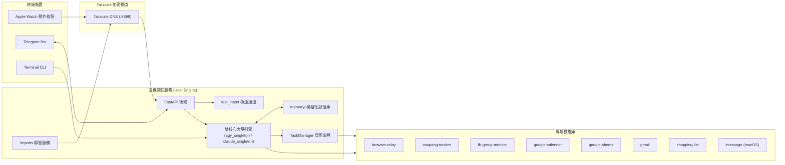

# 🏛️ Personal Assistant (私有化常駐個人 AI 助理)

專為 **本機私有化常駐（macOS / Windows / Linux）** 與 **穿戴行動裝置（Apple Watch、iPhone、Telegram）** 設計的高效能個人 AI 助理。

由您的個人主機（Mac mini、Windows PC、Linux 迷你伺服器等）擔任「大腦與記憶中樞」，支援**雙核心常駐大腦引擎（Google Antigravity CLI / Gemini 或 Anthropic Claude Code CLI）**，結合 **FastAPI** 驅動，維護本地模組化的永久記憶庫，並透過 Tailscale 加密網道提供全天候秒級安全連線。

---

## 🌟 核心架構亮點

1. **⚡ 雙核心常駐大腦引擎 (Dual Brain Engine: AGY / Claude)**：
   - **Antigravity CLI (`agy`) 模式**：預設引擎，預熱常駐 `stream-json` 行程，支援 Low / Med / High 三級思考大腦分流，對話延遲由 2.4s 降至 **<0.6s**。
   - **Claude Code CLI (`claude`) 模式**：原生支援 Anthropic Claude 模型常駐進程池（`claude_singleton.py`），具備獨立 Session 與上下文保護防線，透過 `.env` 變數 `AGENT_ENGINE=claude` 一鍵無縫切換。
   - 內建 **Context 上下文防線**：對話超過閾值（30%）或閒置超時自動重啟，確保記憶體永不膨脹。
2. **🧠 秘書級模組化長效記憶庫 (`memory/`)**：
   - 解耦為 `profile.md`（身分與溝通分流）、`preferences.md`（生活與系統偏好）、`projects.md`（專案目標）與 `notes.md`（重要備忘）。
   - **Google Calendar 待辦唯一真實來源**：所有日常日程與待辦一律寫入日曆，杜絕過期文字堆積。
   - 每日夜間自動排程執行 LLM 審查與 Git 自動提交歸檔。
3. **📱 三大溝通管道與模式分流**：
   - **終端機開發模式 (CLI)**：不受長度限制，完整 Markdown 結構、代碼區塊與架構討論。
   - **Apple Watch 穿戴模式**：按下 Action Button 語音隨口交代，手錶彈出 200 字內簡短卡片，兩端 **1:1 鏡像同步**。
   - **Telegram 雙向通訊**：隨時收發文字、照片辨識、語音輸入，並即時產出報表連結。
4. **⚙️ 背景任務守護神 (`task_manager.py`) 與 Fast Handoff**：
   - 耗時任務（價格監控、社團雷達等）秒級登記脫鉤，主大腦立即釋放，背景 Worker 獨立輪詢並在命中時主動推播。
5. **🛡️ Browser Relay 真實 Chrome 自動化**：
   - 直接操控本機真實 Google Chrome（Chrome-Assistant Profile），跨平台原生支援 macOS、Windows 與 Linux，零外掛依賴，天然免疫 Cloudflare / Akamai 等驗證盾。

---

## 🏛️ 系統架構圖



---

## 📦 模組化技能庫與載入架構 (`skills/` ➔ `.agents/skills/`)

本系統採**模組化軟連結（Symlinks）架構**，所有開發完成的技能存放於 `skills/` 總庫，僅在使用者選中時透過相對符號連結動態掛載至 `.agents/skills/`，有效節省 Prompt Token 並避免 AI 意圖誤判。

| 技能模組 | 類別 | 預設狀態 | 核心功能 |
| :--- | :--- | :--- | :--- |
| **`setup-wizard`** | 核心 | 🔒 **必備** | 互動式與 LLM 對話式設定嚮導，管理身分、金鑰與技能開關 |
| **`browser-relay`** | 核心 | 🔒 **必備** | 操控本機真實 Chrome 進行 DOM 辨識、填表、點擊與批次動作（抗驗證盾） |
| **`google-calendar`** | 生產力 | 🟢 **啟用** | Google 行事曆日程查詢、新增、自訂日曆 API 動態比對與「待辦事項」維護 |
| **`google-sheets`** | 生產力 | 🟢 **啟用** | 通用 Google Sheets 管理：支援試算表網址自動解析 ID、表頭動態對齊搜尋、讀寫與追加 |
| **`gmail`** | 生產力 | 🟢 **啟用** | 透過 Google Workspace CLI 安全搜尋與多線程並發讀取郵件摘要 |
| **`shopping-list`** | 生產力 | 🟢 **啟用** | 家庭通用待買清單：支援日常生鮮、日本代購、3C家電等多情境地點分類、批次新增與快速勾銷 |
| **`imessage`** | 通訊 | ⚪ *可選* | 透過 macOS 原生 AppleScript 安全發送 iMessage（白名單防誤發） |
| **`coupang-tracker`** | 電商 | ⚪ *可選* | 酷澎雙軌通用價格監控（購物車直連 + 搜尋比價），破盤自動通報 |
| **`fb-group-monitor`** | 社群 | ⚪ *可選* | 監控 FB 社團最新貼文，以 LLM 語意條件自動篩選並即時推播 |
| **`shopee-seller`** | 電商 | ⚪ *可選* | 拍照自動視覺辨識商品、產生文案、圖床壓縮、CDP 批次自動上架 |

### 🛠️ 技能管理指令 (CLI & LLM 均支援)

```bash
# 列出所有技能與當前啟用狀態
python3 setup.py skills list

# 技能前置相依性與外部授權健檢 (Doctor)
python3 setup.py skills doctor
python3 setup.py skills doctor google-calendar

# 檢視或更新特定技能設定參數
python3 setup.py skills config google-calendar --set GOOGLE_CALENDAR_TODO_ID="primary"

# 啟用/停用指定技能
python3 setup.py skills enable imessage shopee-seller
python3 setup.py skills disable coupang-tracker

# 批量設定啟用清單（其餘選配自動停用）
python3 setup.py skills set google-calendar,google-sheets,imessage
```

> 💡 **LLM 對話隨時開關與健檢**：您可直接在對話中說「**幫我啟用 iMessage 技能**」、「**把待辦日曆 ID 設為 primary**」或「**幫我檢查行事曆技能狀態 (doctor)**」，助理會自動執行相應指令並即時回報！

---

## 🚀 快速上手指南

### 1. 系統需求
- **作業系統**：跨平台原生支援 **macOS**（Sonoma / Sequoia 等）、**Windows 10/11**（原生直接支援，免 WSL）、或 **Linux**（Ubuntu / Debian 等家用伺服器）
- **硬體**：任何可常駐連網的電腦設備（Mac mini、MacBook、Windows PC、迷你主機等）
- **軟體環境**：
  - Python 3.11+（推薦使用 [uv](https://github.com/astral-sh/uv) 管理）
  - [Google Chrome](https://www.google.com/chrome/)（用於真實瀏覽器自動化）
  - [Google Antigravity CLI (`agy`)](https://github.com)
  - [Tailscale](https://tailscale.com/)（用於穿戴裝置與手機之安全內網連線）

### 2. 安裝與設定虛擬環境
```bash
# 複製專案
git clone <your-repo-url> personal-assistant
cd personal-assistant

# 使用 uv 建立虛擬環境並安裝相依套件
uv venv

# 啟用環境 (macOS / Linux)
source .venv/bin/activate
# 或 Windows (PowerShell)
# .venv\Scripts\Activate.ps1

# 安裝依賴
uv pip install -e .
```

### 3. 一鍵初始化設定嚮導 (推薦)
我們提供了全自動的互動式設定嚮導，自動引導填寫主人身分、Telegram Token、自動偵測 Tailscale 網域並自動生成安全金鑰：

```bash
# 啟動互動式設定嚮導
python3 setup.py
# 或使用 ./start.sh setup
```

> 💡 **對話式設定**：服務啟動後，您亦可隨時在 Antigravity CLI 或 Telegram 對話中說「**幫我設定個人資訊**」或「**初始化設定**」，直接呼叫內建的 `setup-wizard` 技能以對話方式完成配置！

### 4. 啟動服務 (手動啟動 vs 開機自啟)

系統提供多種運行方式，可依您的使用情境選擇：

#### 🔹 模式 A：前台手動啟動 (開發除錯最推薦)
能直接在終端機查看即時思考、工具調用與錯誤訊息：
```bash
# macOS / Linux:
./start.sh

# Windows (PowerShell):
.\start.ps1

# 或跨平台通用直接指令:
uv run uvicorn main:app --host 0.0.0.0 --port 8899
```

#### 🔹 模式 B：背景不掛斷啟動 (終端關閉繼續跑)
```bash
# macOS / Linux:
nohup ./start.sh > data/assistant.log 2>&1 &
```

#### 🔹 模式 C：開機常駐守護 (全天候家電模式，防重開機失聯)
若您經常透過 Apple Watch 隨身交代，建議掛載為系統常駐守護（支援開機自啟與崩潰自動重啟）：
- **macOS (`launchd`)**：
  參考 `scripts/com.user.personal-assistant.plist.example`，將設定檔複製至 `~/Library/LaunchAgents/` 並以 `launchctl load` 載入即可。
- **Windows (工作排程器)**：
  在 PowerShell 以系統管理員執行：
  ```powershell
  $action = New-ScheduledTaskAction -Execute "uv" -Argument "run uvicorn main:app --host 0.0.0.0 --port 8899" -WorkingDirectory "$PWD"
  $trigger = New-ScheduledTaskTrigger -AtLogOn
  $settings = New-ScheduledTaskSettingsSet -RestartCount 999 -RestartInterval (New-TimeSpan -Minutes 1) -ExecutionTimeLimit 0
  Register-ScheduledTask -TaskName "PersonalAssistant" -Action $action -Trigger $trigger -Settings $settings
  ```

啟動後，API 預設監聽於 `http://0.0.0.0:8899`。

#### 🔹 模式 D：多實例與不同大腦獨立運行 (Multi-Instance)
系統支援透過 `ENV_FILE` 與動態埠號在同一台電腦並行多個助理實例（例如 port 8899 跑生產環境，port 8900 跑測試或 Claude 大腦）：
```bash
# 實例 1：生產環境 (讀取 .env，Port 8899，預設 agy 引擎)
./start.sh

# 實例 2：測試環境 (讀取 .env.test，Port 8900，例如設定 AGENT_ENGINE=claude)
ENV_FILE=.env.test ./start.sh
```

---

## ⌚ Apple Watch 與穿戴裝置捷徑設定

透過 iPhone / Mac 的「捷徑 (Shortcuts)」App 建立語音捷徑，並綁定到 **Apple Watch 側邊「動作按鈕 (Action Button)」** 或錶面複雜功能，即可實現抬手一鍵隨口交代助理：

### 🛠️ 步驟 1：建立新捷徑
1. 開啟 iPhone 的 **「捷徑」** App 點擊右上角 **「+」**，命名為 `問問助理`。
2. 點擊詳細資訊 (ⓘ 圖示)，勾選 **「在 Apple Watch 上顯示」**。

### 📝 步驟 2：依序加入 4 個動作
1. **【聽寫文字 (Dictate Text)】**：語言選「繁體中文 (台灣)」，停止聽寫選「暫停後」。
2. **【取得 URL 內容 (Get Contents of URL)】**：
   - **URL**：`http://<您的_TAILSCALE_DOMAIN>:8899/api/chat`
   - **方法**：`POST`
   - **標頭 (Headers)**：
     - `Content-Type`: `application/json`
     - `X-Agent-Key`: `<您在 .env 設定的 ASSISTANT_API_KEY>`
   - **要求內文 (JSON)**：文字鍵值 `query` ➜ 帶入步驟 1 的 **【聽寫的文字】**
3. **【取得辭典值 (Get Dictionary Value)】**：
   - 金鑰：`reply`，來源：步驟 2 的 **【來自 URL 的內容】**
4. **【顯示結果 (Show Result)】**：
   - 文字：帶入步驟 3 的 **【辭典值】**（手錶安靜震動並彈出清晰卡片，點一下即關閉；若想朗讀可改用「朗讀文字」）。

### ⌚ 步驟 3：綁定 Apple Watch 動作按鈕
在 Apple Watch 上開啟「設定」➜「動作按鈕」➜「動作」選「捷徑」➜ 選擇「問問助理」。只要隨身攜帶的 iPhone 上開啟 Tailscale VPN，手錶發出的所有請求便能自動安全直連家中的主機！

---

## 🛠️ 常見維護指令與測試

```bash
# 本地相容性測試驗證 (跨平台 Windows/Linux/macOS 語法與邏輯)
uv run pytest

# 查看背景任務列表 (TaskManager)
python3 task_manager.py list

# 停止背景任務
python3 task_manager.py kill "<任務名稱>"

# 手動同步與審查今日記憶
python3 memory_scheduler.py --once

# 追蹤最新 GitHub Actions CI 狀態
gh run list -L 3
gh run watch <run_id>
```

---

## 📄 License
MIT License
